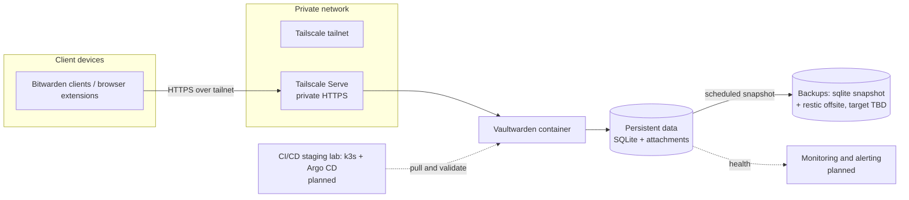

# vaulteD

Config-as-code for a private, self-hosted password-management stack built
around the upstream [Vaultwarden](https://github.com/dani-garcia/vaultwarden)
container image — consumed, not forked. This repository contains
infrastructure config, scripts, tests, pipelines, and docs; it contains no
application code.

> **Standing**: vaulteD orchestrates Vaultwarden, an *unofficial* community
> server compatible with Bitwarden clients. It is not affiliated with
> Bitwarden Inc. See [SECURITY.md](SECURITY.md).

## Status: Phase 0 — bootstrap

The repository skeleton, guardrails, and docs exist. **Nothing here deploys a
working instance yet.** Phase 1 (deployment) is next; see the roadmap.

## Architecture overview

Trust boundaries: client devices authenticate to the tailnet; only tailnet
members reach Tailscale Serve; Vaultwarden binds only to the Serve endpoint;
backup stores are reachable only by the host. Details in
[docs/architecture.md](docs/architecture.md).

## Roadmap

| Phase | Scope | Status |
| ----- | ----- | ------ |
| 0 | Repo skeleton, guardrails, docs | In progress (this issue) |
| 1 | Debian VM host, Docker Compose deployment, Tailscale Serve | Planned |
| 2 | Backups: sqlite `.backup` snapshot + restic, offsite target decision | Planned |
| 3 | Monitoring and alerting | Planned |
| 4 | CI: lint, gitleaks, docs checks in GitHub Actions | Planned |
| 5 | Staging lab: k3s + Argo CD (GitOps) | Planned |

## Getting started

- End users: [docs/getting-started/using-vaulted.md](docs/getting-started/using-vaulted.md)
- Contributors: [docs/getting-started/dev-environment.md](docs/getting-started/dev-environment.md)
- Test VM host: [docs/getting-started/test-vm-debian.md](docs/getting-started/test-vm-debian.md)

Contributing and release process: [CONTRIBUTING.md](CONTRIBUTING.md).
Report vulnerabilities per [SECURITY.md](SECURITY.md).

## License

[MIT](LICENSE).
