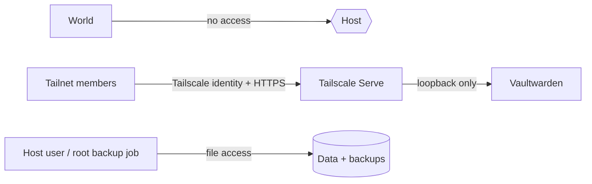

# Architecture

vaulteD is a thin orchestration layer around Vaultwarden. Every component
below is either a container, a service on the host, or config in this repo.

## Components

- **Vaultwarden container** — the password vault. Pulled as an upstream
  image, never forked or patched. State lives in one data directory.
- **Docker Compose (production runtime)** — defines the service, its volume,
  and its restart policy. One host, one service, minimal moving parts.
- **Tailscale + Tailscale Serve** — private overlay network; Serve exposes
  Vaultwarden on a tailnet-internal HTTPS URL. No public ports, no public
  domain, no reverse proxy tier.
- **Backups** — a scheduled `sqlite3 .backup` snapshot (consistent copy while
  the vault is live) plus [restic](https://restic.net) for encrypted,
  deduplicated offsite copies.
- **k3s + Argo CD (staging lab, planned)** — same stack deployed via
  Kustomize-first GitOps for learning and change validation before touching
  the Compose host.

## Trust boundaries

- The public internet has **no** network path to the vault; ports are closed
  by design.
- Only authenticated tailnet devices reach Tailscale Serve, and Serve only
  proxies to Vaultwarden.
- The host (its SSH access, disk, and backup credentials) is the crown
  jewels: anyone with host access owns the vault data. Backups are encrypted
  client-side by restic before leaving the host.
- Account-level security (2FA, recovery codes) is documented for end users in
  [docs/getting-started/using-vaulted.md](getting-started/using-vaulted.md).

## Open decisions

- **Offsite backup target** — undecided. The options:
  - **Backblaze B2**: cheap object storage; third party holds ciphertext only;
    needs lifecycle management.
  - **Cloudflare R2**: no egress fees for restores; slightly newer ecosystem;
    same third-party-trust model as B2.
  - **Second machine over Tailscale**: no external party; but both copies can
    be lost if the tailnet/host is compromised or the machines share a fate.
- Record decisions as ADRs in [docs/adr/](adr/); see
  [docs/adr/0000-template.md](adr/0000-template.md).
